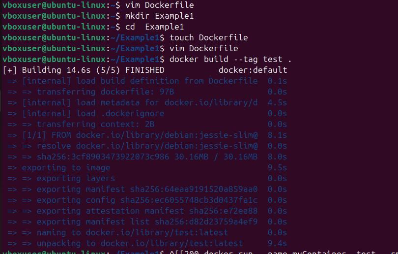
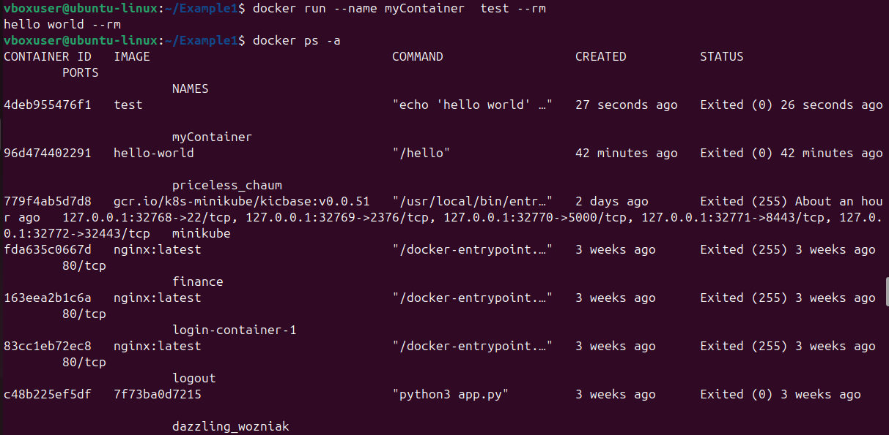
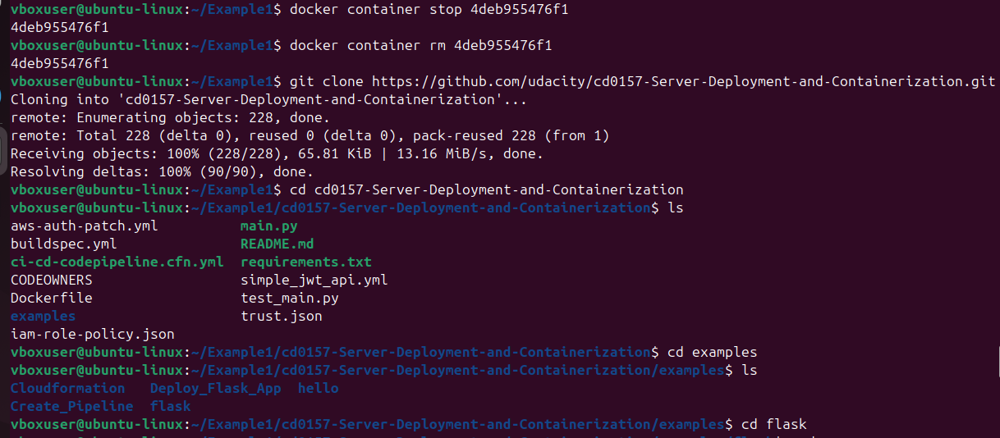
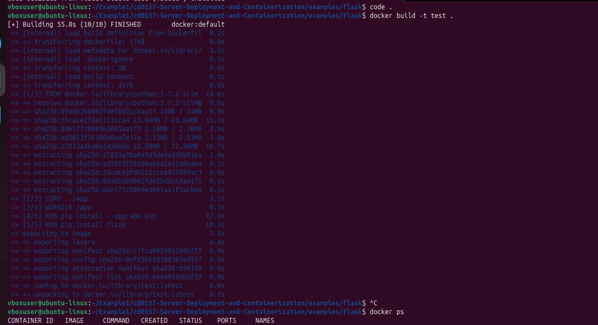
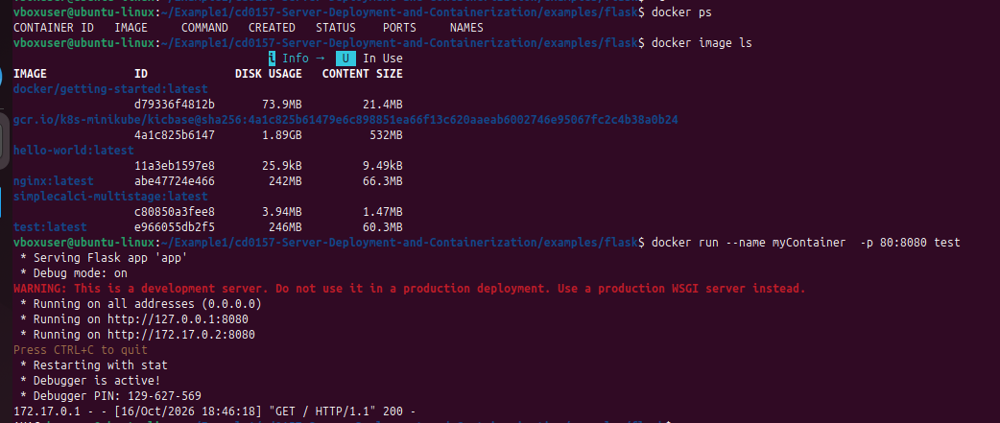
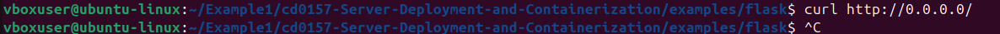
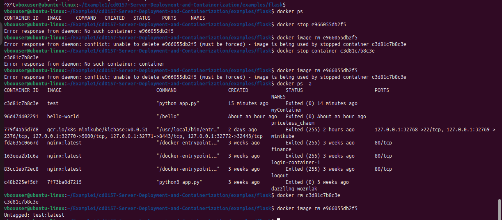

# Docker Containerization: Hello World and Flask App

Two hands-on exercises on containerizing applications with Docker,
from the Udacity Server Deployment and Containerization course.

## Key concepts
- **Docker**: packages an app and everything it needs into one portable
  unit that runs the same on any machine.
- **Dockerfile**: a text file of instructions for building an image.
- **Image**: a read-only template built from a Dockerfile.
- **Container**: a running instance of an image.
- **FROM**: sets the base image to start from.
- **ENTRYPOINT**: the command that runs when the container starts.
- **Port mapping (-p 80:8080)**: connects port 80 on my machine to the
  port the app listens on inside the container (8080).
- **Build context (.)**: the folder Docker uses to find the Dockerfile.

## Workflow
Dockerfile -> docker build -> Image -> docker run -> Container -> Access (curl) -> Clean up

## Example 1: Hello World
    cd example1-hello-world
    docker build --tag test .
    docker run --rm --name myContainer test

## Example 2: Flask app
    cd example2-flask
    docker build -t test .
    docker run --name myContainer -p 80:8080 test
    curl -i http://localhost:80/

## Clean up
    docker ps -a
    docker stop <container_id>
    docker rm <container_id>
    docker image rm <image_id>

## Walkthrough

### Example 1: Hello World
1. Created the Dockerfile and built the image
   
2. Ran the container. I put --rm after the image name as written in the
   exercise, so it was passed to the container as text (output: hello world --rm)
   and the container was not removed.
   

### Example 2: Flask app
3. Cloned the course repo
   
4. Built the Flask image
   
5. Ran the container with port mapping 80:8080
   
6. Accessed the app with curl
   
7. Cleaned up: removed the container first, then the image
   

## What I learned
- How a Dockerfile becomes an image and then a running container
- Port mapping between host and container
- docker run options must come before the image name, otherwise they
  are passed to the container as arguments
- Container ID and image ID are different; docker stop needs the container ID
- A container must be removed before the image it uses can be removed
- debian:jessie-slim is outdated; alpine:latest works as a replacement

## Source
Exercises from the Udacity Server Deployment and Containerization course.
